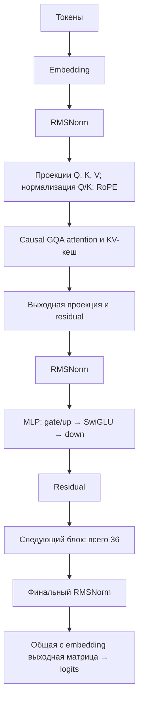

# ДЗ №1. Анализ и ускорение Qwen3-4B на Apple M3 Pro

## 1. Выбор модели и контекст применения

Для работы я выбрал **Qwen/Qwen3-4B** — языковую модель для генерации текста. Я запускаю её на своём MacBook и рассматриваю как помощника для объяснения понятий, подготовки текстов и работы с небольшими документами на русском языке.

Меня интересует **инференс**: получение ответов от готовой модели без обучения. Предполагаю одного пользователя, до одного запроса в минуту и обработку запросов по одному (batch size 1). Для замеров беру короткий вопрос и запрос с более длинным контекстом. Длину ответа ограничиваю 128 новыми токенами.

Для такого помощника я хочу получать первый токен не позднее чем через 2 секунды, а дальнейший ответ — со скоростью хотя бы 10 токенов/с. Также важно, чтобы модель оставляла достаточно памяти для обычной работы за ноутбуком.

Я остановился на размере 4B, чтобы сравнить исходную и квантованную модель на одном устройстве. У версии 8B только 16-битные веса заняли бы около 16 ГБ — почти всю доступную память.

В обоих вариантах отключаю режим рассуждений (`enable_thinking=False`), чтобы сравнивать скорость при одинаковых настройках. Подробнее о модели: [карточка Qwen3-4B](https://huggingface.co/Qwen/Qwen3-4B).

## 2. Целевая аппаратная платформа

Для запуска я использую MacBook с **Apple M3 Pro**, **18 ГиБ объединённой памяти** и macOS 26.6.2. Объём памяти проверил командой `sysctl -n hw.memsize`.

**MLX-LM — библиотека для запуска языковых моделей на Mac, которая через MLX и графический API Apple Metal выполняет вычисления на встроенном GPU.** Она также поддерживает квантование весов. Версии зависимостей сохранены в [requirements.txt](../requirements.txt), описание библиотеки — в [репозитории MLX-LM](https://github.com/ml-explore/mlx-lm).

У M3 Pro процессор и GPU используют общую память. Эти 18 ГиБ делят между собой модель, macOS и остальные приложения. По грубой оценке, исходные 16-битные веса модели на 4 млрд параметров занимают около 8 ГБ. Дополнительно нужна память для промежуточных вычислений и KV-кеша — сохранённых ключей и значений attention для уже обработанных токенов.

Если памяти не хватает, система начинает переносить данные на SSD (своп), что замедляет работу. Даже когда модель помещается в память, скорость её чтения может ограничивать генерацию. Подробнее об общей памяти: [описание M3 от Apple](https://www.apple.com/newsroom/2023/10/apple-unveils-m3-m3-pro-and-m3-max-the-most-advanced-chips-for-a-personal-computer/).

На скорость ноутбука также влияют нагрев, режим питания и фоновые приложения. Энергопотребление в этой работе я не измеряю.

## 3. Архитектура модели

Qwen3-4B построена на decoder-only Transformer: модель предсказывает следующий токен по предыдущим. Каждый токен проходит через все 36 блоков. Размерности я взял из `config.json` и сверил с реализацией Qwen3 в MLX-LM.

| Параметр | Значение |
|---|---:|
| Число decoder-блоков | 36 |
| Размер скрытого состояния, d | 2560 |
| Промежуточный размер MLP, m | 9728 |
| Число query-голов, Hq | 32 |
| Число key/value-голов, Hkv | 8 |
| Размер головы, h | 128 |
| Размер словаря | 151 936 |
| Максимальная позиция в конфигурации | 40 960 |
| Формат исходных весов | BF16 |
| Общие веса входного embedding и выходной проекции | Да |

Размер проекции Q равен `32 × 128 = 4096` и отличается от размера скрытого состояния 2560. Это нужно учитывать при расчёте вычислений. Доступная длина контекста на ноутбуке будет зависеть от свободной памяти.

**Attention.** Проекции создают Q, K и V; RoPE кодирует положение токенов, causal mask исключает обращение к будущим позициям. Используется grouped-query attention: четыре query-головы разделяют одну пару KV-голов. Это уменьшает объём KV-кеша по сравнению с 32 отдельными KV-головами, но attention всё равно выполняется для всех query-голов.

**MLP.** Две проекции расширяют скрытое состояние до 9728, SwiGLU объединяет их результаты, третья проекция возвращает размер 2560. Эти крупные матрицы составляют значительную часть весов и вычислений.

**Нормализации и residual-связи.** Нормализации регулируют масштаб значений, а residual-связи прибавляют вход блока к его выходу. Они дешевле крупных матричных операций по FLOPs, но создают обращения к памяти и запуски GPU-операций.

**Выходная проекция.** Переводит скрытое состояние в оценки для большого словаря. Совместное использование весов с embedding экономит хранение, но не отменяет вычисления logits.

## 4. Вычислительные затраты и узкие места

Инференс делится на **prefill** — обработку входного текста — и **decode** — последовательное получение новых токенов. При prefill модель обрабатывает много токенов совместно, лучше переиспользуя веса. При decode с batch=1 на каждом шаге обрабатывается один новый токен; следующий шаг зависит от предыдущего.

### Расчётные оценки

Чтобы оценить объём вычислений, я считаю умножение и сложение за 2 операции (FLOPs). Для одного токена в одном блоке получается:

- MLP: `6dm ≈ 149 млн FLOPs`.
- Проекции Q/K/V/O: `4d(Hq + Hkv)h ≈ 52 млн FLOPs`.
- На MLP приходится около 74% операций в этих линейных преобразованиях.

Для 36 блоков получается около 7,27 млрд FLOPs линейных преобразований на токен. Выходная проекция добавляет около `2 × 2560 × 151936 ≈ 0,78 млрд FLOPs`. Здесь не учтены attention по контексту, нормализации, активации и служебные операции.

Для длины контекста S вычисления attention имеют порядок `O(Hq × S² × h)` при prefill и `O(Hq × S × h)` на новый токен при decode с кешем. Оптимизированные реализации attention позволяют выполнять эти вычисления без хранения всей матрицы внимания.

Объём обычного 16-битного KV-кеша:

`M_KV = 2 × L × B × S × Hkv × h × 2 байта`.

При L=36, B=1, Hkv=8 и h=128 это **144 КиБ на токен**, около **576 МиБ на 4096 токенов** и **4,5 ГиБ на 32768 токенов**. Служебные данные и запас выделенной памяти в эту оценку не входят. Квантование весов само по себе не уменьшает этот кеш.

### Узкие места

| Потенциальное узкое место | Почему возникает здесь | Как проверить и что из этого следует |
|---|---|---|
| Чтение весов при decode | Большие матрицы многократно читаются для одного токена, переиспользование при batch=1 ограничено | Сравнить скорость генерации с исходными и 4-битными весами |
| Линейные операции MLP и attention-проекций | Большие размерности и 36 последовательных блоков | Раздельно измерить prefill/decode; расчёты выделяют MLP как крупную статью FLOPs |
| Attention и KV-кеш на длинном контексте | С каждым токеном растёт объём предыдущих K/V, к которым обращается модель | Менять длину входа при одинаковом лимите выхода; следить за TTFT и памятью |
| Общий бюджет памяти | Веса, кеш, временные тензоры, ОС и приложения конкурируют за 18 ГиБ | Следить за общей занятостью памяти и свопом |
| Накладные расходы библиотеки | Много небольших операций, синхронизации, Python-цикл выдачи токенов | Прогреть модель и измерять генерацию отдельно от загрузки |
| Холодный запуск и дисковый I/O | Загрузка нескольких гигабайт весов до первого запроса | Отдельная метрика холодного старта; текущий benchmark оценивает уже загруженную модель |

Главная гипотеза для проверки: при генерации по одному токену уменьшение объёма весов ускорит их чтение и повысит скорость ответа. Замеры покажут общий эффект; время отдельных GPU-операций я здесь не измеряю.

## 5. Системные ограничения

Для моего сценария самое важное ограничение — память: модель должна помещаться вместе с кешем и не вызывать интенсивный своп. Затем идут задержка первого токена и скорость ответа. Ускорение имеет смысл, только если ответы остаются полезными и корректными.

Обработка большого числа запросов в секунду здесь менее важна: я запускаю модель для одного пользователя. Поэтому объединение запросов в большой батч не является приоритетом. Также я предпочитаю способы, которые можно применить к готовым весам без отдельного обучения.

## 6. Гипотезы по ускорению

| Метод | Какие части затрагивает и механизм | Когда полезен | Когда эффект ограничен |
|---|---|---|---|
| **4-битное квантование весов** | Матрицы линейных слоёв и embedding: меньше хранимых и читаемых байтов; специализированные операции над упакованными весами | Нехватка памяти или медленное чтение весов при генерации | Распаковка весов тоже требует времени; обработка входа может ускориться слабее |
| **Ограничение контекста и повторное использование общего префикса** | Меньше prefill-вычислений и KV-данных; кеш префикса исключает повторную обработку одинакового начала | Длинная история, повторяющийся системный промпт | Уникальные запросы не используют общий префикс; удаление истории теряет информацию |
| **Квантование KV-кеша** | Уменьшает память и чтение ключей/значений при длинном контексте | Кеш становится заметной частью бюджета | На коротком контексте выигрыш мал; дополнительные преобразования и возможная потеря качества |
| **Kernel fusion и оптимизированный attention** | Уменьшают промежуточные записи, чтения и число запусков операций | Обработка длинного входа и множество мелких операций | Часть оптимизаций уже есть в MLX; дополнительный выигрыш может быть небольшим |
| **Дистилляция в меньшую модель** | Уменьшает число/размер блоков, память весов и вычисления, используя ответы или распределения учителя | Есть стабильная узкая задача, данные и ресурс на обучение | Для универсального помощника нужны разнообразные данные и отдельное обучение |
| **Структурный pruning** | Удаляет блоки, головы или каналы с последующим восстановлением качества | Есть данные для отбора и дообучения, runtime поддерживает изменённые размеры | Простое обнуление весов обычно не ускоряет обычное матричное умножение; возможно падение качества |
| **Batching** | Несколько запросов совместно используют чтение матриц | Сервис с большим числом одновременных запросов | При одном пользователе ожидание новых запросов только увеличит задержку |

Для эксперимента я выбрал **4-битное квантование весов**: оно уменьшает потребление памяти и не требует обучения. Формат Q4 — affine, группы по 64 значения; масштабы и смещения также занимают память, поэтому итоговый размер не равен строго четверти BF16. При этом уменьшается точность весов; активации и KV-кеш остаются в исходном формате.

Исходные веса уже используют BF16, поэтому в эксперименте я сравниваю BF16 и Q4.

## 7. Инженерные компромиссы

| Решение | Ожидаемый выигрыш | Цена и риск |
|---|---|---|
| Q4 весов | Меньше памяти, возможное ускорение decode | Ошибка округления меняет logits и ответы; зависимость от реализации GPU-операций |
| Сокращение контекста | Меньше TTFT, памяти и attention-вычислений | Потеря важных фактов из истории |
| Кеширование префикса | Меньше повторных вычислений | Дополнительная память и логика корректного переиспользования |
| Q4/Q8 KV-кеша | Возможность обработать более длинный вход | Потеря точности attention, расходы преобразований |
| Fusion | Меньше накладных расходов без намеренного изменения модели | Сложнее диагностика и переносимость; возможны численные отличия |
| Студент или pruning | Снижение затрат всей модели | Данные, обучение, регрессии качества, отдельная поддержка новой модели |

В этой работе я проверяю квантование весов. Дистилляцию и pruning рассматриваю как возможные следующие шаги: они требуют данных и дополнительного обучения.

## 8. Эксперимент

Для замеров я подготовил [скрипт](../benchmarks/run.py). Исходную модель и её Q4-версию запускаю отдельно, с одинаковыми промптами и настройками: batch=1, выбор наиболее вероятного токена (greedy decoding), рассуждения отключены, максимум 128 новых токенов.

Для каждого промпта сначала делаю прогрев, затем три измерения. В таблице приведены медиана и диапазон min–max. Загрузку весов и токенизацию не включаю во время ответа. Между запросами кеш не сохраняю; внутри одного ответа модель использует KV-кеш для предыдущих токенов.

Измеряю время до первого токена (TTFT), скорость обработки входа (prefill), скорость генерации (decode), полное время и пиковую память MLX. Последний показатель учитывает память библиотеки, а не всей системы. Если модель завершает ответ раньше лимита, при сравнении времени учитываю фактическое число токенов.

| Метрика, медиана [min–max] | BF16, короткий | Q4, короткий | BF16, длинный | Q4, длинный |
|---|---|---|---|---|
| Длина входа/выхода, токенов | 35 / 128 | 35 / 128 | 797 / 128 | 797 / 128 |
| TTFT, с | 0.215 [0.211–0.232] | 0.123 [0.123–0.123] | 1.222 [1.220–1.254] | 1.173 [1.172–1.175] |
| Prefill, токенов/с | 163.2 [151.3–166.3] | 286.7 [286.4–286.8] | 652.8 [636.5–653.9] | 679.9 [678.5–680.4] |
| Decode, токенов/с | 15.0 [14.6–15.8] | 52.9 [52.7–53.0] | 15.1 [15.0–15.2] | 50.9 [50.7–51.2] |
| Полное время, с | 8.785 [8.330–9.026] | 2.558 [2.554–2.565] | 9.721 [9.686–9.788] | 3.700 [3.685–3.717] |
| Peak MLX, ГБ | 8.125 [8.125–8.125] | 2.475 [2.475–2.475] | 8.611 [8.611–8.611] | 3.210 [3.210–3.210] |

Прогрев исключён из таблицы. Исходные записи: [BF16](../results/baseline.jsonl) и [Q4](../results/q4.jsonl).

Ускорение decode рассчитывается как `tokens/s(Q4) / tokens/s(BF16)`, ускорение TTFT — как `TTFT(BF16) / TTFT(Q4)`. Снижение памяти: `1 − peak(Q4)/peak(BF16)`. Все сравнения делаются отдельно для каждого промпта.

### Сравнение ответов

Я просмотрел сохранённые ответы на оба запроса. После квантования формулировки изменились. В коротком ответе BF16 объясняет кеш как маленькую память, а Q4 использует менее точное выражение «информация, которая хранится в быстром месте». При этом и у BF16 есть неточность: объяснение начинается с поиска данных в основной памяти, хотя в контексте процессорного кеша порядок другой.

На длинном запросе оба варианта начинают план улучшения поддержки с анализа текущей ситуации. Однако все ответы дошли до лимита 128 токенов и оборвались. Для сравнения скорости длина получилась одинаковой, но оценить полноту ответа по этим фрагментам нельзя. Двух запросов недостаточно, чтобы сделать общий вывод о сохранении качества.

### Выводы по эксперименту

Квантование дало основной выигрыш на этапе генерации: скорость выросла с 15,0 до 52,9 токена/с на коротком запросе (**в 3,53 раза**) и с 15,1 до 50,9 на длинном (**в 3,36 раза**). Полное время получения 128 токенов сократилось с 8,79 до 2,56 секунды и с 9,72 до 3,70 секунды соответственно.

На длинном входе первый токен появился лишь немного раньше: 1,173 вместо 1,222 секунды. Скорость обработки этого входа выросла примерно на 4%. Получается, что квантование гораздо сильнее помогло последовательной генерации, чем обработке длинного промпта. Это согласуется с предположением, что при batch=1 чтение весов заметно ограничивает decode.

Пиковая память MLX снизилась с 8,12 до 2,47 ГБ на коротком запросе (**на 69,5%**) и с 8,61 до 3,21 ГБ на длинном (**на 62,7%**). Экономия меньше теоретических 75% для самих весов: кроме них, память занимают кеш, промежуточные данные и параметры квантования.

Оба варианта уложились в выбранные ориентиры: первый токен за 2 секунды и генерация быстрее 10 токенов/с. Для своего ноутбука я бы выбрал Q4: ответ появляется быстрее, а для остальных приложений остаётся больше памяти. Перед использованием для важных задач я бы дополнительно проверил качество на более длинных ответах.

Во время этих запусков я отдельно не записывал своп, режим питания и фоновую нагрузку. Поэтому полученные коэффициенты относятся к этим коротким замерам на моём MacBook; при другой нагрузке они могут измениться.

## Источники и воспроизводимость

1. [Qwen3-4B: карточка модели](https://huggingface.co/Qwen/Qwen3-4B).
2. [Qwen3-4B: конфигурация](https://huggingface.co/Qwen/Qwen3-4B/blob/main/config.json); значения сверены с локально скачанным checkpoint.
3. [MLX-LM](https://github.com/ml-explore/mlx-lm) и [реализация Qwen3](https://github.com/ml-explore/mlx-lm/blob/main/mlx_lm/models/qwen3.py); архитектурный анализ сверен с установленной версией из requirements.txt.
4. [Apple: архитектура семейства M3](https://www.apple.com/newsroom/2023/10/apple-unveils-m3-m3-pro-and-m3-max-the-most-advanced-chips-for-a-personal-computer/).
5. [Материалы курса: profiler.ipynb](https://github.com/asmaslov/damcourse_ai/blob/master/profiler.ipynb). Пример использует ResNet18 и PyTorch CUDA/CPU profiler. Из примера я взял подход с прогревом и отдельным измерением работы модели. Для своего MacBook использую MLX вместо CUDA.
